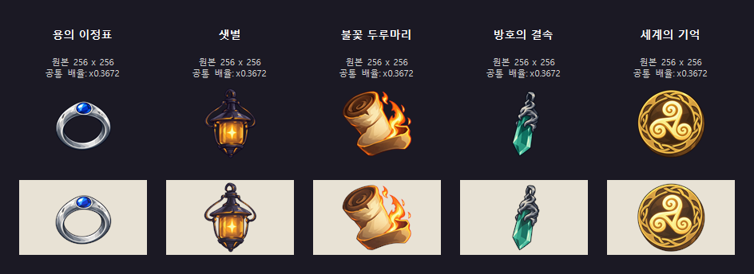
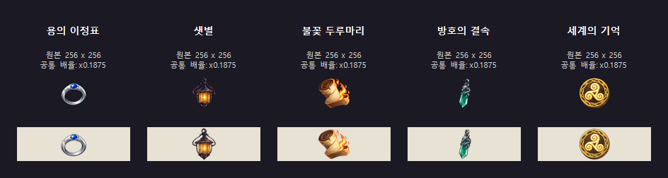

# 메르쿠리우스 유물 아이콘 시안

사용자가 지정한 이름과 참고 이미지로 다섯 유물을 각각 제작했다. 용의 이정표는 푸른 보석이 박힌 낡은 은반지이며, 나머지 네 점은 등불·두루마리·녹색 보석 목걸이·금빛 문양의 형태를 단순화했다.

| 이름 | 큰 이미지 · 256px | 작은 아이콘 · 94px | 흰색 외곽선 · 94px |
|---|---|---|---|
| 용의 이정표 | [PNG](big/mercurius_dragons_waymark.png) | [PNG](small/mercurius_dragons_waymark.png) | [PNG](small/mercurius_dragons_waymark_outline.png) |
| 샛별 | [PNG](big/mercurius_morning_star.png) | [PNG](small/mercurius_morning_star.png) | [PNG](small/mercurius_morning_star_outline.png) |
| 불꽃 두루마리 | [PNG](big/mercurius_flame_scroll.png) | [PNG](small/mercurius_flame_scroll.png) | [PNG](small/mercurius_flame_scroll_outline.png) |
| 방호의 결속 | [PNG](big/mercurius_bond_of_protection.png) | [PNG](small/mercurius_bond_of_protection.png) | [PNG](small/mercurius_bond_of_protection_outline.png) |
| 세계의 기억 | [PNG](big/mercurius_memory_of_the_world.png) | [PNG](small/mercurius_memory_of_the_world.png) | [PNG](small/mercurius_memory_of_the_world_outline.png) |

내장 이미지 생성 도구를 사용했다. 공통 제작 지침은 배경 없는 단일 물체, 굵고 읽기 쉬운 윤곽, 재질별 큰 명암 면, 작은 크기에서 구분되는 주요 문양이다. 샛별의 중심 빛은 별 모양으로, 불꽃 두루마리의 마법은 주황·금빛 불꽃으로, 방호의 결속은 녹색 결정과 은빛 용 장식으로, 세계의 기억은 세 갈래 나선과 간단한 금빛 테두리로 표현했다.

원본 전체를 비례 축소했으며 잘라내지 않았다. 외곽선은 최종 작은 아이콘의 알파에서 만들었다. 2026-10-26 유물 효과 구현 요청에 따라 다섯 아이콘을 런타임 경로에 연결하고 패키지 로드를 확인했다. 게임 설치와 Git 업로드는 하지 않았다. 효과와 확인 범위는 [메르쿠리우스 설계](../../mercurius.md)를 따른다.

용의 이정표는 사용자 피드백에 따라 네 번째 시안으로 갱신했다. 높게 솟은 보석 받침을 없애고, 푸른 보석이 은반지 표면에 낮게 박힌 형태를 유지하면서 알의 면적과 볼륨을 조금 키웠다. 낡은 은의 재질과 매끈한 고리 형태는 유지했다.
